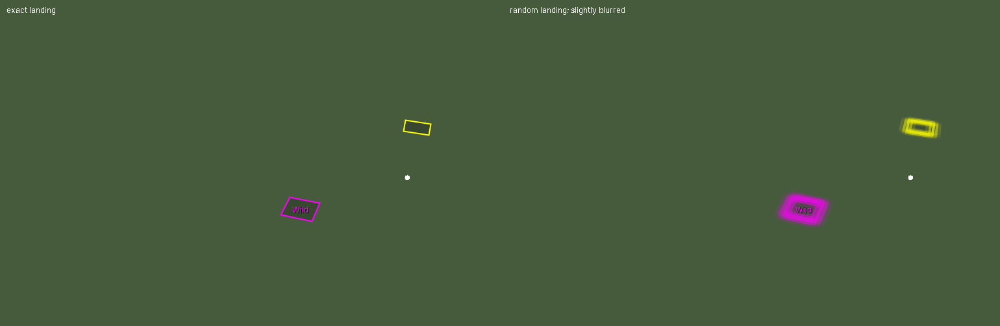

# Teleport Tile Markers

A RuneLite plugin that shows the tiles you marked with the **Tile Markers** plugin at a teleport's destination
*while you are still teleporting*, so you know where to put your mouse before you land.

Mark the tile in front of the Edgeville bank booth, rub your glory, pick Edgeville, and the marker appears on screen
straight away, in the spot it will be once you arrive.



## How it works

- **Recognising the teleport.** The plugin watches what you click: spells (`Cast Varrock Teleport`), tablets,
  scrolls, worn jewellery and capes (`Edgeville` on a worn glory), sub-menus (`Rub` → `Fire Altar`), and
  dialogs or lists opened by an item (`Rub` a glory, then click `Edgeville` or press its key). Where one click
  can go to different places, it checks your spellbook, house location and the varbits the data names (the
  Arceuus Respawn Teleport, Teleport to House, diary-upgraded items). If it still can't tell, it shows nothing
  rather than guess.
- **Networks and rides too**, about 1,440 destinations in all:
  - Fairy rings: the code is read from the dials when you press Confirm (as RuneLite's Fairy Ring plugin reads
    it), or from a ring's "Last-destination (CKS)" or "Zanaris" option.
  - Spirit trees, magic mushtrees, gnome gliders, quetzals, Lovakengj minecarts, the Mountain Guide and the
    Dorgeshuun guides: the stop you pick, by click or key.
  - Your house's jewellery box (by its keys), portal nexus and mounted glory, digsite pendant, Xeric's talisman
    and mythical cape.
  - Into your house: Teleport to House, the house tablet, a Construction or Max cape's "Home", the town house
    portals ("Home", "Build mode", or "Enter" then "Go to your house"), and the garden's spirit tree and fairy
    ring. The house is an instance laid out by you, so the plugin learns it: each time you arrive it remembers
    which room is where and the tile you arrived on (per account), and the next trip shows your house's markers.
    The first trip into a new or rebuilt house shows nothing.
  - Into other instances (raids, minigames, boss rooms): the same way. Most are built the same every time, so
    after one trip the plugin remembers the instance and the tile you arrived on, per teleport, and the next trip
    shows your markers in it. The first trip there shows nothing.
- **When it learns something** on a trip (your house's layout or arrival tile, or what a "last destination"
  means), the destination's markers flash 3 times once you land, drawn on top of your tile markers. Nothing
  flashes when what it saw is already known. *Forget learned data* forgets all of it for the account (it asks
  first).
  - Rides from a fixed place: levers, portals, charter ships, boats and ferries, canoes, hot air balloons, magic
    carpets, carts and lifts. A ride only counts when you click it near where it's boarded, and you may walk
    there first; "Walk here" instead cancels it.
  - Quest-only travel is left out.
- **Destinations you set yourself.** These follow the varbits the game's own scripts read:
  - Varrock/Grand Exchange, Camelot/Seers' and Watchtower/Yanille spells: the toggle only changes which option is
    the left click. `Cast` always goes to the first place and the named option to the second, so the option you
    click says where you go.
  - The same tablets' `Break` goes where their `Toggle` last set it (varbits 4585, 4560, 4548). The house
    tablet's `Break` goes outside when the house is set to teleport outside (varbit 4744); inside the house is an
    instance, so nothing is shown.
  - "Last destination" on quetzal whistles, the Ring of the elements and Pharaoh's sceptre: the game keeps the
    place in a varbit (9950, 13708, 13838), but nothing says which value means which place. The plugin learns it:
    each time you land from one of the item's ordinary teleports, it remembers that place for the varbit's value
    then. Until it has seen a value, "last destination" shows nothing.
- **Drawing the markers.** The camera follows you, so a tile 5 east of where you'll land will be drawn 5 tiles
  east of you once you arrive. The plugin draws each destination marker that far from where you stand now, using
  your camera's angle and zoom, and takes the ground as flat at your height. It reads your markers straight from
  the Tile Markers plugin's saved data, using that plugin's colours, labels, border width and fill.
- **Random landings.** Teleports that land in a zone the OSRS Wiki draws are drawn with a soft blur that fades out
  from a sharp outline (like a gaussian blur; *Blur distance* sets how far), placed as if you
  land in the middle of the zone ("lands within 2 tiles of this point", or the middle of an outlined area). A
  zone belongs to the landing spot, not just the page that drew it: the Camelot Teleport spell lands in the zone
  the Camelot tablet's page draws, so both are blurred. That's about 200 teleports. The zones were read from the OSRS
  Wiki at development time; the plugin never contacts the Wiki. Every other teleport is drawn sharp, exactly on its
  destination tile.
- The markers disappear when you land (the Tile Markers plugin takes over), if the teleport doesn't start within
  3 ticks, or if you walk off during a home teleport.

## Settings

| Setting | Default | What it does |
| --- | --- | --- |
| Show on click | on | Show markers as soon as you click. Off: wait for the teleport animation. |
| Draw distance | 32 | Markers up to this many tiles (up to 100) from where you will land. |
| Snap to true tile | off | Place the markers from the tile you are really on, so they move a tile at a time. Off: they follow your character smoothly. |
| Show on minimap | on | Also draw the markers on the minimap. |
| Opacity | 100% | How strongly the markers are drawn, compared with normal tile markers. |
| Line thickness | 1 px | How thick the outlines are, in pixels. 0: the Tile Markers plugin's border width. |
| Blur random landings | on | For teleports with a random landing tile, draw a soft blur around each marker's sharp outline. |
| Blur distance | 30% | How far that blur fades out from the outline, as a share of a tile's width. |
| Hide uncertain landings | off | Don't show markers for teleports that could land *Hide when off by* tiles or more away. |
| Hide when off by | 2 tiles | How far off a landing can be before it is hidden. Zones of unknown size are still shown. |
| Flash when learned | on | Flash the destination's markers 3 times when a trip teaches the plugin something new. |
| Forget learned data | off | Tick to forget your house's layout, instances and items' last destinations (asks first, can't be undone). |
| **Colours** | | |
| Override marker colour | on | Draw every preview marker's outline and label in *Marker colour*. |
| Marker colour | #FF00C8FF (light blue) | The outline and label colour for the override. |
| Override fill colour | on | Fill every preview marker with *Fill colour*. |
| Fill colour | #0A00C8FF (faint light blue) | The fill colour for the override. |
| Override text colour | on | Draw every preview marker's label in *Text colour*. |
| Text colour | white | The label colour for the override. |
| **Override threshold** | | |
| Override threshold | on | Apply the overrides only to markers whose own outline opacity passes the test below. |
| Override when | Any | Any (every marker, the threshold is ignored), or above, below or exactly the threshold. |
| Threshold | 26 (about 10%) | The outline opacity to compare with: alpha 0-255, as in the colour pickers. |

The plugin only ever reads your Tile Markers. The overrides, the blur and the opacity change only how this
plugin draws its preview; your marked tiles and their colours are never changed.

## Limits

- Hills and stairs at the destination aren't known before you arrive, so markers on sloped ground can sit
  slightly off until you land.
- Not covered yet, as the data doesn't say how they're started or where they land: the Lake Molch, Great Conch
  and Burgh de Rott boats, Fossil Island's rowboats, Wilderness obelisks, eagles, the Abyss (a random spot on
  its outer ring), Keldagrim's minecarts from Keldagrim, and the Fairy Resistance Hideout's four-code ring.
- Networks and rides land exactly on the data's tile; none of them is drawn blurred.
- "Last destination" items show nothing for a place until you've teleported there once with that item's normal
  options.
- Banker's briefcase, Evil eye and the clue compass aren't in the bundled data.

## Feedback and support

Found a bug, a teleport that shows the wrong tiles, or have an idea? Join the Discord server at
[https://discord.gg/E6tRDDzYxW](https://discord.gg/E6tRDDzYxW) and post in the Teleport Tile Markers channels.

## Building

```
./gradlew build          # compile and run the tests
./gradlew run            # start a development RuneLite with the plugin loaded
./gradlew shadowJar      # build/libs/teleport-pre-tile-1.0.0-all.jar starts RuneLite with the plugin
```

To log in to the development client, follow RuneLite's
[Using Jagex Accounts](https://github.com/runelite/runelite/wiki/Using-Jagex-Accounts) guide.

## Licence

BSD 2-Clause, see [LICENSE](LICENSE). The teleport data comes partly from the OSRS Wiki, under CC BY-NC-SA 3.0. See
[THIRD_PARTY_NOTICES.md](THIRD_PARTY_NOTICES.md).
