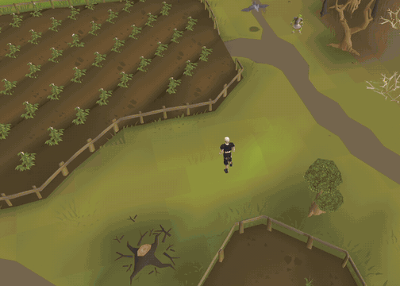
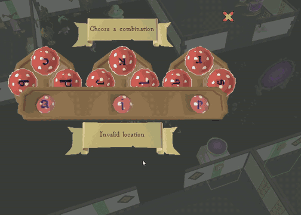
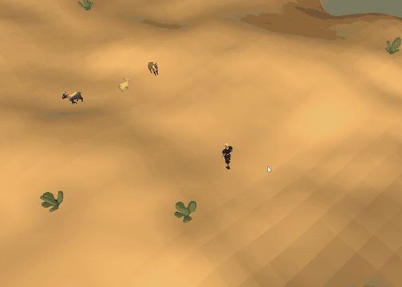

# Teleport Tile Markers

Shows your **Tile Markers** at a teleport's destination *while you're still teleporting*, so your mouse is in place
before you land.

Mark the tile in front of the Edgeville bank, rub your glory, pick Edgeville, and the marker appears straight away
where it will be when you arrive.







## Settings

| Setting | Default | What it does |
| --- | --- | --- |
| Show on click | on | Show markers as soon as you click. Off: wait for the teleport animation. |
| Draw distance | 32 | Show markers up to this many tiles from where you land (max 100). |
| Snap to true tile | off | Move the markers a tile at a time with your true tile, instead of smoothly. |
| Show on minimap | on | Also show the markers on the minimap. |
| Opacity | 100% | How strongly the markers are drawn. |
| Line thickness | 1 px | Outline thickness. 0 uses the Tile Markers plugin's border width. |
| Blur random landings | on | Blur the markers of teleports that land on a random tile nearby. |
| Blur distance | 30% | How far the blur fades out, as a share of a tile. |
| Hide uncertain landings | off | Hide teleports that can land *Hide when off by* tiles or more away. |
| Hide when off by | 2 tiles | How far off a landing can be before it's hidden. |
| Flash when learned | on | Flash the markers when a trip teaches the plugin something new. |
| Learn ground height | on | Remember the ground's height where you land, so later trips line up on hills and steps. |
| Forget learned data | off | Forget everything learned on this account (asks first). |
| **Colours** | | |
| Override marker colour | on | Draw preview outlines and labels in *Marker colour* (light blue). |
| Override fill colour | on | Fill preview markers with *Fill colour* (faint light blue). |
| Override text colour | on | Draw preview labels in *Text colour* (white). |
| **Override threshold** | | |
| Override threshold | on | Only override markers whose own opacity passes the test below. |
| Override when | Any | Any (every marker), or above, below or equal to *Threshold*. |
| Threshold | 26 | The opacity (0-255) to compare with. |

Your tile markers are only ever read, never changed.

## How it works

- **It reads your clicks.** Spells, tablets, scrolls, jewellery and capes (worn, in the inventory or from a
  sub-menu), item dialogs, fairy rings, spirit trees, gliders, quetzals, minecarts, your house's jewellery box,
  portal nexus and mounted glory, and rides like boats, levers and carpets. About 1,440 destinations in all.
- **Never a guess.** If a click could go to more than one place and the plugin can't tell which, it shows nothing.
- **Random landings** (about 200 teleports, from the OSRS Wiki's landing zones) are drawn blurred around the
  middle of the zone. Everything else lands exactly on its tile.
- **It learns as you go**, per account:
  - your house and other instances, after one trip inside;
  - the ground's height at a destination, after one trip there;
  - where "last destination" items (quetzal whistle, Ring of the elements, Pharaoh's sceptre) go, after you've used
    their normal options.

  The first trip shows nothing (or flat markers). When something new is learned, the markers flash: in your
  override colour, or each marker's own colour inverted.
- **Toggle teleports** (Varrock/GE, Camelot/Seers', Watchtower/Yanille, house tablet) follow your current setting.
- The markers disappear when you land and the Tile Markers plugin takes over.

## Limits

- Not covered yet: the Lake Molch, Great Conch and Burgh de Rott boats, Fossil Island rowboats, Wilderness obelisks,
  eagles, the Abyss, Keldagrim's minecarts from Keldagrim, the Fairy Resistance Hideout ring, Banker's briefcase,
  Evil eye and the clue compass.
- Quest-only travel is left out.

## Feedback and support

Bugs, wrong tiles or ideas: join the Discord server at [https://discord.gg/E6tRDDzYxW](https://discord.gg/E6tRDDzYxW)
and post in the Teleport Tile Markers channels.

## Building

```
./gradlew build          # compile and run the tests
./gradlew run            # start a development RuneLite with the plugin
```

## Licence

BSD 2-Clause, see [LICENSE](LICENSE). Teleport data comes partly from the OSRS Wiki (CC BY-NC-SA 3.0), see
[THIRD_PARTY_NOTICES.md](THIRD_PARTY_NOTICES.md). The plugin never contacts the Wiki.
